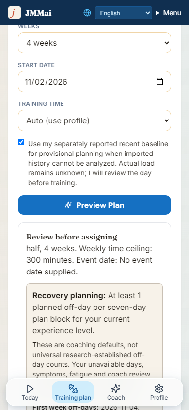
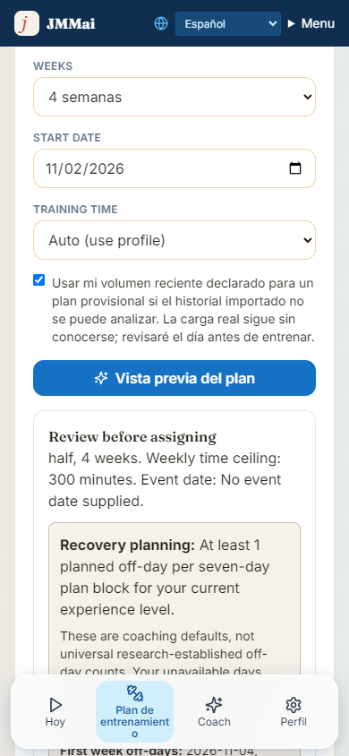

# Coach model and manual-baseline cycle repair

## Behavior

The optional text coach defaults to `gpt-6-astra`. Explicit supported legacy model settings remain supported; failures do not switch models or providers. Reasoning requests use `reasoning_effort: low`, a bounded 8192-token completion budget, no temperature, `store: false`, and a 45-second provider deadline. The assistant route allows 60 seconds. This is a quality-first candidate, not a claim of benchmark superiority or account availability.

Existing per-request consent, provenance boundaries, isolated dialogue memory, validated output, and server-owned writes remain in force. The model upgrade does not permit external analysis of imported athlete data. Core training prescriptions remain deterministic and independent of an AI API key.

Sources checked November 2, 2026:

- [Official model capabilities](https://developers.openai.com/api/docs/models/gpt-6-astra).
- [Official migration quickstart](https://developers.openai.com/api/docs/guides/latest-model/gpt-6-astra.md#migration-quickstart): reasoning parameters and removal of temperature.

## Training generation

Previously, one restricted or unknown-origin activity prevented generation even when an athlete had a separately reported recent baseline. Default behavior still rejects that history for derived coaching analytics.

The athlete can explicitly choose provisional planning from their separately reported baseline. This requires the existing valid planning setup and the athlete's own session; a coach acting on another account cannot make this choice. Imported activity remains restricted, source records remain unchanged, totals remain unknown, performed dates remain protected, and recovery review stays required. This is not a way to relabel an imported summary as manual input.

The choice is bound into the preview fingerprint and saved cycle metadata. Changing it requires a new preview. The checkbox and confirmations reset across athletes. Existing event protection, capacity limits, sport coverage, transactional conflict checks, duplicate prevention, completed history, daily safety checks, and workout approval/export gates remain intact. There is no automatic activation, PUSH upgrade, or production-data migration.

## Verification and release gates

Local verification: typecheck, targeted ESLint and production build passed. The full working-checkout suite passed 2266/2266 (including five pending dual-domain tests outside this PR). The production build retained existing hook-dependency warnings. The initial Windows Prisma engine file lock cleared when tests finished; the retry passed.

`scripts/jmm-manual-baseline-ui-smoke.cjs` runs against a local production server at port 3147 with fully intercepted synthetic API responses and external network requests blocked. English and Spanish at 390px passed: unchecked default, blocked implicit request, explicit preview, choice invalidation and no horizontal overflow or page errors. This is UI simulation, not real-account save acceptance.

- Focused route tests exercise default restriction, explicit manual planning, unchanged source records, preview mismatch rejection, and confirmation without execution approval.
- Provider tests exercise request compatibility, consent, structural isolation, invalid configuration, bounded failures and no provider fallback.
- Live production inspection confirmed configured AI capability after the owner added a key. This is not proof that the provider accepted a chat request, billing is enabled, or the flagship model is accessible.
- Live existing-account cycle preview reproduced the restricted-history blocker without replacing the saved plan.
- Live AI response, flagship latency/quality benchmark, production cycle replacement, reload and delivery remain acceptance gates after an approved release. No real athlete data should be used in an external model benchmark.

Do not merge or deploy this branch without the owner's approval. Branch auto-deployment is disabled. Pending dual-domain edits are separate work.
